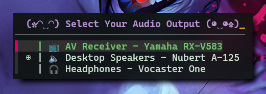

# sinkswitch
### Pipewire/Wireplumber output/sink swichter for scratchpads in [Hyprland](https://hypr.land/), [mangowm](https://mangowm.github.io/) and other WM's with scratchpad support.


## :beginner: Description
The tool spawns a little menu running in your terminal to switch between your pipewire audio outputs(sinks). It was written with Hyprland and it's [Special Workspace's (aka scratchpad's)](https://wiki.hypr.land/configuring/core/dispatchers/#special-workspaces) in mind, but also works on [mangowm](https://mangowm.github.io/) or any other compositor that got a scratchpad feature aswell([Sway](https://github.com/swaywm/sway) etc.), or you can run it just in the terminal if you wish to.
<br/>

## :dna: Dependencies
Most modern distro's already use pipewire & wireplumber as their audio backend/frontend, the only thing you might need to install as a dependency is [fzf](https://github.com/junegunn/fzf).

### List of dependencies
- **pipewire:** The core audio system on most modern distro's
- **wireplumber:** The default pipewire session manager most modern distro's use
- **wpctl:** CLI tool that let's you work with wireplumber, comes with wireplumber by default
- **terminal:** I use kitty, but any should work, just use what you already have
- **[fzf](https://github.com/junegunn/fzf):** The tool used to dislpay the fancy menu. Can be found in nearly every modern distro's package repository and manager
<br/>

## :floppy_disk: Installation
Open a terminal and navigate to where you want to store the script (Example: **`~/scripts/`** =  somewhere inside your home directory would be suitable).
Then use curl **or** wget to download the script:
```sh
curl -O  https://raw.githubusercontent.com/Seyloria/sinkswitch/main/sinkswitch.sh
```
```sh
wget https://raw.githubusercontent.com/Seyloria/sinkswitch/main/sinkswitch.sh
```
### Make the script executable
```sh
chmod +x sinkswitch.sh
```
<br/>

## :link: Scratchpad Config

<details>
<summary>Click to see the current Hyprland lua config</summary>

### hyprland.lua
Add this windowrule to your **`hyprland.lua`**. Tweak the **monitor**, **move** coordinates and **size** to adjust the displayed scratchpad to fit your needs.
This example uses a 3440x1440px monitor and scratchpad size is tailored to fit 3 entries. The menu is spawned in the top right of the screen.

### Hyprland since v0.55.0 = lua
```lua
hl.window_rule({
    name = "scratchpad-kitty-sinkswitch",
    match = { class = "kitty-sinkswitch" },
    monitor = "DP-1",
    float = true,
    move = "2936 72",
    size = "480 140",
})
```

### Keybinding Example since v0.55.00
This example uses an extra macro key on the keyboard, but you can assign it to any key of your choosing.
```
hl.bind("XF86Tools", hl.dsp.exec_cmd(
    "kitty --class kitty-sinkswitch -e ~/scripts/sinkswitch.sh -color-prompt red -color-selection green -dflag ✠",
    { workspace = "special:sinkswitch" }
```

### Waybar Integration
If you want to use a button on your waybar(e.g. from your volume control) to open the menu, this can easily be done by executing the script with **`hyprctl dispatch`**.

Example:
```jsonc
"pulseaudio": {
        "format": "{icon}   {volume}%",
        "tooltip": false,
        "format-muted": " Muted",
        "on-click": "hyprctl dispatch 'hl.dsp.exec_cmd(\"kitty --class kitty-sinkswitch -e ~/scripts/sinkswitch.sh -color-prompt red -color-selection green -dflag ✠\", { workspace = \"special:sinkswitch\" })'",
        "on-scroll-up": "pamixer -i 5",
        "on-scroll-down": "pamixer -d 5",
        "scroll-step": 5,
        "max-length": 10,
        "states": {
        		"low!": 30,
        		"critical!": 15
        },
},
```
</details>

<details>
<summary>Click to see old pre v0.55.0 Hyprland config</summary>

### hyprland.conf
Add this windowrule to your **`hyprland.conf`**. Tweak the **monitor**, **move** coordinates and **size** to adjust the displayed scratchpad to fit your needs.
This example uses a 3440x1440px monitor and scratchpad size is tailored to fit 3 entries. The menu is spawned in the top right of the screen.
        
### Hyprland v0.53.0 - v0.54.0
```
windowrule = match:class kitty-sinkswitch, monitor DP-1, float on, move 2936 64, size 480 160
```

### Hyprland till v0.52.2
```
windowrule = monitor DP-1, float, move 2936 64, size 480 160, class:kitty-sinkswitch
```
### Keybinding Example old syntax pre v0.55.00
This example uses an extra macro key on the keyboard, but you can assign it to any key of your choosing.
```
bind = , XF86Tools, exec, [workspace special:sinkswitch] kitty --class kitty-sinkswitch -e ~/scripts/sinkswitch.sh -exclude 46
```
### Waybar Integration
If you want to use a button on your waybar(e.g. from your volume control) to open the menu, this can easily be done by executing the script with **`hyprctl dispatch`**.

Example:
```sh
"pulseaudio": {
        "format": "{icon} {volume}%",
        "tooltip": false,
        "format-muted": " Muted",
        "on-click": "hyprctl dispatch exec \"[workspace special:sinkswitch] kitty --class kitty-sinkswitch -e ~/scripts/sinkswitch.sh -exclude 46\"",
        "on-scroll-up": "pamixer -i 5",
        "on-scroll-down": "pamixer -d 5",
        "scroll-step": 5,
        "max-length": 10,
        "states": {
        		"low!": 30,
        		"critical!": 15
        },
},
```

</details>

<details>
<summary>Click to see mangowm scratchpad config</summary>

### mangowm

Example scratchpad for mangowm. Add this to your `[env]` section in your `config.toml`.
Edit the the properties to your liking.

```toml
[env]

#------------------------------#
# --> WINDOW & LAYER RULES <-- #
#------------------------------#

#--> CUSTOM SCRATCHPADS <--
#--> sinkswitch scratchpad on DP-1
[[rule.window_rule]]
is_named_scratchpad = 1
is_floating = 1
no_border = 1
width = 470
height = 160
monitor = "DP-1"
offset_x = 0
offset_y = -94
title = "sinkswitch-scratch"
```

For a keybind add such to your `[bind.default]` section and edit the the properties to your liking.

```toml
[bind.default]

"XF86Tools" = "toggle_named_scratchpad,none,sinkswitch-scratch,kitty -T sinkswitch-scratch bash /home/rorian/scripts/sinkswitch.sh -color-prompt magenta -color-selection green -dflag ✠"
```

</details>

<br/>

## :triangular_flag_on_post: Command-line Options

All available options and flags:

| Option | Description |
| --- | --- |
| `-h` | Show the help menu with all available options |
| `-color-prompt <color>` | Choose what color your prompt(header) should have |
| `-color-selection <color>` | Choose what color your selection should have |
| `-dflag <marker/symbol>` | Choose a fixed-width marker/symbol for the current default sink |
| `-exclude <ids>` | Hide device IDs from the menu (comma-separated list). Run `wpctl status` to find IDs. |
| `-nick` | Show sink nicknames instead of descriptions (adds `--nick` flag to wpctl)<br>For advanced renaming see the [Rename outputs (sinks)](#abc-rename-outputs-sinks) segment |
| `-notify` | Send a desktop notification (using notify-send) when sink changes |
| `-notify-hypr` | Send a Hyprland native notification (using hyprctl) when sink changes |

### Examples:
```sh
# Show help menu
sinkswitch -h

# Choose what color your prompt(header) should have
sinkswitch -color-prompt red

# Choose what color your selection should have
sinkswitch -color-selection cyan

# Choose a fixed-width marker/symbol for the current default sink
sinkswitch -dflag ◆  

# Create a menu with excluded sinks and send notification
sinkswitch -exclude 46,63 -notify

# Display sinks with nicknames
sinkswitch -nick

# Use Hyprland notification
sinkswitch -notify-hypr

# Combine multiple options
sinkswitch -exclude 45,60 -sync -notify-hypr -nick -dflag ⦿
```

## :no_entry_sign: Exclude/Hide certain outputs(sinks)
If you want to hide one or more outputs(sinks) from your menu, you can do so by calling the script with the **`-exclude`** flag, followed by a comma seperated list of sink id's to hide.
Show all sinks and their id's:
```sh
wpctl status
```
**Output:**
```
Audio
 ├─ Devices:
 │      49. Navi 21/23 HDMI/DP Audio Controller [alsa]
 │      50. Vocaster One USB                    [alsa]
 │      51. Radeon High Definition Audio Controller [alsa]
 │      52. Ryzen HD Audio Controller           [alsa]
 │  
 ├─ Sinks:
 │      46. Yamaha RX-V583                      [vol: 1.00]
 │      63. 📺 AV Receiver - Yamaha RX-V583   [vol: 0.60]
 │      64. 🎧 Headphones - Vocaster One      [vol: 0.85]
 │  *   65. 🔈 Desktop Speakers - Nubert A-125 [vol: 0.20]
 │  
```
Then use the id's you want to hide and include them when calling the script:<br/>
Example: **`~/scripts/sinkswitch.sh -exclude 46,63`**

### Exclude sinks via excludes.conf and make persistent
A better and persistent way to exclude sinks that also survives reboots is to create a file called `excludes.conf`.

#### How-to
Put a file called `excludes.conf` next to the script, or at `~/.config/sinkswitch/excludes.conf`
Find the sink(s) <id> to hide with: `wpctl status`
Find the node.name with: `wpctl inspect <id> | grep node.name`
Copy the *node.name* **`value`** into the `excludes.conf`
Hides sinks by node.name, one per line. Lines starting with # are comments.

### Example excludes.conf
```conf
alsa_output.usb-Focusrite_Vocaster_One_USB_V1V15632A08AAF-00.HiFi__USB1__sink
alsa_output.pci-0000_03_00.1.hdmi-surround-extra3
```

<br/>

## :abc: Rename outputs (sinks)
If you are not happy with the default sink names and the **`-nick`** flag doesn't please you either, you can change the sink name by using a wireplumber rule. This changes the **`node.description`**, so no need for the **`-nick`** flag this way.
Make a new file named like this in the following directory:

**`/home/username/.config/wireplumber/wireplumber.conf.d/50-rename-outputs.conf`**

You can get the **`node.name`** and current **`node.description`** with
```sh
pw-cli list-objects Node
```
After editing use **`systemctl --user restart wireplumber`**(for systemd users, others know their way) or just **reboot the system** to apply the changes.

**Example `50-rename-outputs.conf`:**
```
monitor.alsa.rules = [
  {
    matches = [
      # This matches the value of the 'node.name' property of the node.
      {
        node.name = "alsa_output.usb-Focusrite_Vocaster_One_USB_V1V15632A08AAF-00.analog-surround-40"
      }
    ]
    actions = {
      # Apply all the desired node specific settings here.
      update-props = {
        node.description = "🎧 Headphones - Vocaster One"
      }
    }
  }
  {
    matches = [
      # This matches the value of the 'node.name' property of the node.
      {
        node.name = "alsa_output.pci-0000_03_00.1.hdmi-surround"
      }
    ]
    actions = {
      # Apply all the desired node specific settings here.
      update-props = {
        node.description = "📺 AV Receiver - Yamaha RX-V583"
      }
    }
  }
  {
    matches = [
      # This matches the value of the 'node.name' property of the node.
      {
        node.name = "alsa_output.pci-0000_13_00.6.iec958-stereo"
      }
    ]
    actions = {
      # Apply all the desired node specific settings here.
      update-props = {
        node.description = "🔈 Desktop Speakers - Nubert A-125"
      }
    }
  }
]
```

## :scroll: Changelog and current state (yyyy-mm-dd)

- [x] 2026-11-25 | v2.0 | Reworked the excludes to survive reboots and scrapped -sync option
- [x] 2026-09-05 | v1.6 | Readme updated for the current hyprland lua syntax
- [x] 2026-04-25 | v1.6 | Added project info to the help flag
- [x] 2026-04-25 | v1.5 | Adds -dflag, color-prompt & color-selection parameter to rice your menu
- [x] 2026-03-24 | v1.4 | Adds -nick parameter to display sink nicknames
- [x] 2026-03-24 | v1.3 | Improves CLI usability with help menu and better argument handling
- [x] 2026-03-24 | v1.2 | Adds notification support for sink switching (notify-send and Hyprland)
- [x] 2026-03-23 | v1.1 | Adds option to sync active streams when switching sink
- [x] 2025-12-28 | v1.0 | Upload the script and create a suitable README


## :sparkling_heart: Thank you
Thank's go out to [Sebastiaan76](https://github.com/Sebastiaan76) and his work on [waybar_wireplumber_audio_changer](https://github.com/Sebastiaan76/waybar_wireplumber_audio_changer) for the idea.

### :cyclone: Disclamer

> **This is a private project and i am not a developer. I am only sharing this because it might help others. If you want to fork it, go ahead! If you find any errors or got suggestions, please let me know!**
